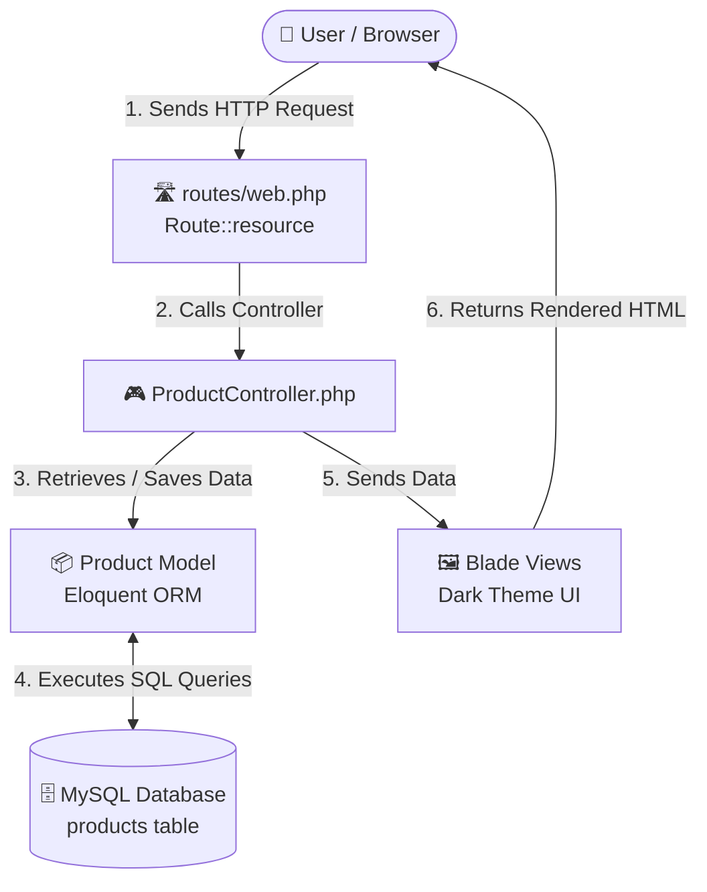

# 🛒 Laravel Product CRUD Application

[](https://laravel.com)
[](https://www.php.net)
[](https://www.mysql.com)
[](LICENSE)

> **Academic Requirement:** Activity No. 2 — Creating CRUD Modules in Laravel  
> **Course:** CCC181: Applications Development and Emerging Technologies  
> **Architecture:** Model-View-Controller (MVC)

---

## 📖 Project Overview

This repository contains a complete **Product Management Web Application** developed with **Laravel 12** and **MySQL**. The project demonstrates essential web development and backend concepts such as database migrations, Eloquent ORM, RESTful resource routing, mass-assignment protection, server-side validation, and dynamic Blade templates.

The application also features a customized **Dark Mode user interface** created using standard CSS without relying on large external UI frameworks.

---

## ✨ Main Features

- 🟢 **Add Products:** Users can create new products while the system validates the product name, quantity, price, and optional description.
- 📋 **View Products:** Displays all stored products in a dynamic table, including formatted prices and stock quantity indicators.
- 🟡 **Edit Products:** Existing product information can be modified through automatically populated edit forms using Laravel's HTTP method spoofing.
- 🔴 **Remove Products:** Products can be permanently deleted after a confirmation prompt.
- 🌙 **Dark Mode Interface:** Provides a modern dark-themed design using slate-based colors such as `#0f172a` and `#1e293b`, along with transitions and focus effects. The interface is implemented using vanilla CSS.
- 🛡️ **Security Measures:**
  - CSRF protection is enabled for form submissions.
  - `$fillable` is used to protect against mass-assignment vulnerabilities.
  - Server-side validation prevents invalid values and negative quantities or prices.
  - `findOrFail()` provides appropriate handling when a requested product does not exist.

---

## 🏗️ Application Architecture

The application uses Laravel's standard **Model-View-Controller (MVC)** architecture.



### Application Flow

1. The user sends a request through the browser.
2. Laravel receives the request through the routes defined in `web.php`.
3. The appropriate method inside `ProductController` processes the request.
4. The `Product` model communicates with the MySQL database through Eloquent ORM.
5. Retrieved or processed data is passed to the appropriate Blade view.
6. The Blade template generates the HTML displayed in the user's browser.

---

## 🛠️ Technologies Used

| Application Layer | Technology |
|---|---|
| **Backend Framework** | Laravel 12 |
| **Programming Language** | PHP 8.2+ |
| **Database System** | MySQL 8.0+ |
| **Object-Relational Mapper** | Eloquent ORM |
| **Template Engine** | Blade |
| **Frontend Styling** | Custom Vanilla CSS |

---

## 📂 Project Directory

The following files contain the main components responsible for the CRUD functionality:

```text
CCC181-LAB2/
├── .env
│   └── Environment and database configuration
├── app/
│   ├── Http/
│   │   └── Controllers/
│   │       └── ProductController.php
│   │           └── CRUD operations and validation
│   └── Models/
│       └── Product.php
│           └── Eloquent model and mass-assignment settings
├── database/
│   └── migrations/
│       └── 2026_09_19_112146_create_products_table.php
│           └── Product database structure
├── resources/
│   └── views/
│       └── products/
│           ├── index.blade.php
│           │   └── Product listing and action buttons
│           ├── create.blade.php
│           │   └── New product form
│           └── edit.blade.php
│               └── Product editing form
└── routes/
    └── web.php
        └── Application resource routes
```

---

## 🗄️ Database Structure

The application's `products` table is created through a Laravel database migration.

| Field | Data Type | Properties | Purpose |
|---|---|---|---|
| `id` | `BIGINT` | Primary Key, Auto Increment, Unsigned | Identifies each product |
| `name` | `VARCHAR(255)` | Not Null | Stores the product name |
| `qty` | `INT` | Not Null | Stores the available stock |
| `price` | `DECIMAL(8,2)` | Not Null | Stores the product price |
| `description` | `TEXT` | Nullable | Contains an optional product description |
| `created_at` | `TIMESTAMP` | Nullable | Records when the product was created |
| `updated_at` | `TIMESTAMP` | Nullable | Records the most recent update |

---

## 🛣️ RESTful Routing

The CRUD functionality is registered through Laravel's resource routing system:

```php
Route::resource('products', ProductController::class);
```

This automatically creates the following routes:

| HTTP Method | URL | Controller Action | Route Name | Purpose |
|:---:|:---:|:---:|:---:|---|
| `GET` | `/products` | `index()` | `products.index` | Shows all products |
| `GET` | `/products/create` | `create()` | `products.create` | Displays the product creation form |
| `POST` | `/products` | `store()` | `products.store` | Validates and saves a new product |
| `GET` | `/products/{id}/edit` | `edit()` | `products.edit` | Opens the selected product for editing |
| `PUT` / `PATCH` | `/products/{id}` | `update()` | `products.update` | Updates an existing product |
| `DELETE` | `/products/{id}` | `destroy()` | `products.destroy` | Removes a product |

> **Additional Note:**  
> Visiting the application's root URL `/` redirects the user to the `/products` page.

---

## 🚀 Installation and Setup

Use the following procedure to install and run the project on a local machine.

### 1. Required Software

Before running the application, make sure the following software is available:

- [PHP](https://www.php.net/) version 8.2 or newer
- [Composer](https://getcomposer.org/)
- [MySQL](https://www.mysql.com/) 8.0 or newer
- XAMPP or MariaDB may also be used as an alternative local database environment.

---

### 2. Configure MySQL

First, make sure your local MySQL server is running. If you are using a Windows service, you can start it through an Administrator PowerShell terminal:

```powershell
net start MySQL80
```

After starting MySQL, create the application's database:

```powershell
mysql -u root -p -e "CREATE DATABASE IF NOT EXISTS `app-crud`;"
```

---

### 3. Configure the Environment File

Open the `.env` file located in the project's root directory and make sure the database configuration corresponds to your local MySQL setup:

```env
DB_CONNECTION=mysql
DB_HOST=127.0.0.1
DB_PORT=3306
DB_DATABASE=app-crud
DB_USERNAME=root
DB_PASSWORD=
```

If your MySQL installation uses a password, replace the empty `DB_PASSWORD` value with your actual database password.

---

### 4. Install Laravel Dependencies

Open a terminal inside the project directory and install the required Composer packages:

```powershell
composer install
```

If the project does not yet have an application key, generate one using:

```powershell
php artisan key:generate
```

Then execute the database migrations:

```powershell
php artisan migrate
```

This creates the required database tables based on the migration files.

---

### 5. Start the Laravel Server

Run the Laravel development server with:

```powershell
php artisan serve
```

After the server starts successfully, open the following address in your browser:

```text
http://127.0.0.1:8000
```

The application should redirect to the product management page.

---

## 🎨 User Interface Design

The application uses a custom dark-themed interface designed to provide a clean and modern appearance.

### Color Scheme

- **Dark Slate (`#0f172a`)** — Main page background
- **Slate (`#1e293b`)** — Cards and elevated content areas
- **Border Slate (`#334155`)** — Borders and visual separation

### Action Colors

- **Emerald (`#10b981`)** — Add, save, and successful operations
- **Blue (`#3b82f6`)** — Edit actions and focus indicators
- **Red (`#ef4444`)** — Delete buttons and error messages
- **Slate Gray (`#64748b`)** — Cancel and secondary actions

### Interactive Elements

The interface includes several small visual effects to improve usability:

- Hover transitions on interactive controls
- Button press animations
- Focus outlines for form fields
- Stock quantity badges
- Smooth visual transitions between interface states

All styling is implemented using **vanilla CSS**, keeping the project lightweight and avoiding dependency on large UI frameworks.

---

## 🧠 Laravel Concepts Demonstrated

### 1. Mass Assignment Protection

The `Product` model uses the `$fillable` property:

```php
protected $fillable = ['name', 'qty', 'price', 'description'];
```

This specifies which model attributes can be assigned through mass-assignment operations such as:

```php
Product::create()
```

or:

```php
$product->update()
```

Restricting assignable fields helps prevent unauthorized parameters from being inserted or modified.

---

### 2. HTTP Method Spoofing

Standard HTML forms only support the `GET` and `POST` methods. Laravel provides method spoofing so that applications can perform RESTful operations such as `PUT`, `PATCH`, and `DELETE`.

For example:

```php
@method('PUT')
```

and:

```php
@method('DELETE')
```

These directives generate a hidden `_method` field that Laravel uses to determine the intended HTTP request method.

---

### 3. CSRF Protection

Forms include Laravel's CSRF directive:

```html
<form action="..." method="POST">
    @csrf
    ...
</form>
```

The `@csrf` directive generates a security token that Laravel verifies when the form is submitted. This protects the application from **Cross-Site Request Forgery (CSRF)** attacks.

---

### 4. Server-Side Validation

Incoming product information is checked before being saved to the database.

Example validation rules:

```php
$request->validate([
    'name'  => 'required|string|max:255',
    'qty'   => 'required|integer|min:0',
    'price' => 'required|numeric|min:0',
]);
```

These rules ensure that:

- A product name is provided.
- The product name is a valid string.
- The name does not exceed 255 characters.
- Quantity is an integer and cannot be negative.
- Price is numeric and cannot be negative.

When validation fails, Laravel automatically redirects the user back to the form while making the validation errors available through `$errors`.

---

## 👤 Academic Information

- **Student / Developer:** Computer Applications Student
- **Course:** CCC181 — Applications Development and Emerging Technologies
- **Activity:** Activity No. 2 — Creating CRUD Modules in Laravel
- **Academic Term:** 1st Semester, A.Y. 2026–2027

---

## 📄 License

This project was created for **academic and educational purposes** and is distributed under the **MIT License**.

See the `LICENSE` file included in the repository for the complete license terms.